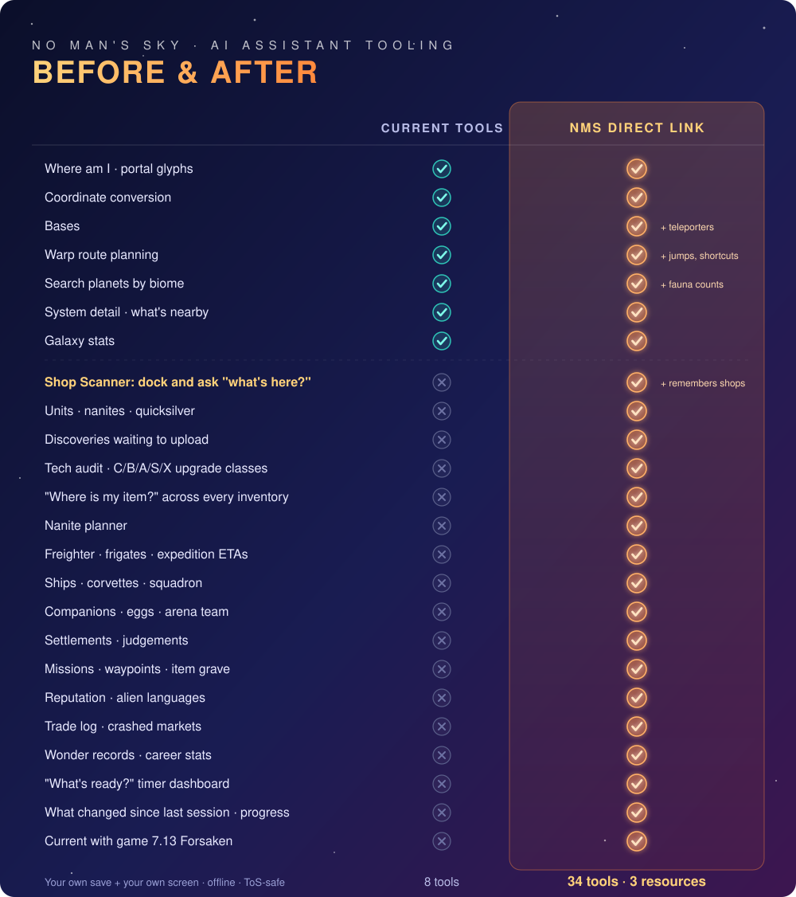

<p align="center">
  
</p>

<p align="center">
  <a href="https://github.com/Zeekeey-jpeg/No-Mans-Sky-Direct-Link/actions/workflows/ci.yml"></a>
  
  
  
  
  <a href="LICENSE"></a>
</p>

# No Man's Sky Direct Link — MCP server for No Man's Sky

<h3 align="center">Give your AI assistant full visibility into your No Man's Sky game.</h3>
<p align="center">A local <a href="https://modelcontextprotocol.io">Model Context Protocol</a> (MCP) server for <strong>No Man's Sky</strong> that reads <em>your own</em> save file and answers questions like<br>
<em>"What's in this shop?" · "Which station had an S-class hyperdrive module?" · "How many nanites do I have and what's the fastest way to 3,000?" · "Where did I leave my Chromatic Metal?"</em></p>

---

## ◆ TL;DR

- **What it is:** an MCP server (`nms-direct-link`) that decodes `save.hg`, de-obfuscates it with the community key mapping, and exposes **34 tools** (33 read-only) to Claude Desktop, Claude Code, or any MCP client.
- **What it never does:** write to your save, touch the game process, read memory, intercept network traffic, or send your data anywhere. The only network call is an optional public community-mission lookup. The only files it writes are a small session-history log and your scanned-shops database, both in your user cache folder.
- **Install:** `pipx install git+https://github.com/Zeekeey-jpeg/No-Mans-Sky-Direct-Link` then add one JSON block to your MCP client. Saves are found automatically (Steam, GOG).
- **Check it works:** `nms-direct-link --self-test`

```
save: C:\Users\you\AppData\Roaming\HelloGames\NMS\st_7656…\save.hg (12 min ago)
version 4745 · Win|Final · mapping libMBIN 7.10.0.1 · unknown keys 0
mode Normal · 41.2 h · units 12,480,300 · nanites 1,930 · quicksilver 450
location Euclid 0863:007C:060B:01AB planet 1 (portal 11AB7E60D865)
inventories 19 · ships 3 · multitools 2 · bases 4 · teleporters 15
discoveries 512 · pending upload 143 {'Mineral': 61, 'Flora': 39, 'Animal': 28, 'Planet': 9, 'SolarSystem': 6}
frigates 7 · expeditions 1 · settlements 1 · missions in progress 24
SELF-TEST OK
```

---

## ◆ Shop Scanner: dock and ask "what's here?"

The game never saves what a merchant is selling. Direct Link reads it the way you do: off the screen.

1. **Dock and open a shop.** Technology merchant, starship outfitter, trade terminal, scrap dealer, mission board, anything.
2. **Ask "what's in this shop?"** Your assistant grabs a screenshot of the game window, reads every item, class and price, and tells you what's worth buying with the nanites and units you actually have.
3. **It remembers.** Every shop you scan is saved against that system. Later, from anywhere: *"Which station had an S-class hyperdrive module under 600 nanites?"* · *"Quick view: what did the shops here sell?"*

Don't want to alt-tab? Press Steam's **F12** at each shop while you play, then ask *"read my screenshots"* once. Every shop gets logged in one go.

| Tool | What it does |
|---|---|
| `nms_look_at_screen` | Screenshot of the No Man's Sky window, handed to your assistant to read |
| `nms_read_screenshots` | Your newest F12 Steam screenshots, for logging several shops at once |
| `nms_log_shop` | Remember a merchant's stock, tied to the system you're in |
| `nms_find_in_shops` | Search every shop you've scanned by item, class, price, currency or merchant, nearest first |
| `nms_get_shops_here` | Quick view of everything scanned in this system |

Run the game **borderless or windowed** for window capture (exclusive fullscreen can capture black). Only the game window is captured: if it isn't found, nothing is taken unless you explicitly ask for the whole screen. Re-scanning a merchant replaces its earlier list. Capture never touches the game process; it's the same as a screenshot tool or OBS. Images go only to the assistant you are talking to.

---

## ◆ Before & after

<p align="center">
  
</p>

Everything the current No Man's Sky MCP tooling can do, Direct Link does too. Then it reads what's on your screen in any shop, and the rest of your save: money, tech, inventories, fleet, corvettes, companions, missions, reputation, trade, records, timers and session-to-session progress.

---

## ◆ Features

**You and your stuff**

| Tool | What your assistant can answer |
|---|---|
| `nms_get_player_state` | Units, nanites, quicksilver, mode, play time, where you are, health, Nexus access, current mission, how old the save is |
| `nms_audit_tech` | Every installed technology and upgrade module with its **C/B/A/S/X class**, damaged tech, free slots, ship and multitool stats |
| `nms_find_item` | "Where is my X?" across exosuit, ships, multitools, freighter, exocraft, storage, cooking and grave inventories |
| `nms_get_hangar` | Every starship and corvette (archetype, class, stats, upgrades), free ship slots, multitools, squadron pilots, hired workers |
| `nms_get_companions` | Creature companions (species, biome, size, predator), eggs, Xeno Arena battle team, unlocked companion slots |
| `nms_get_player_stats` | Lifetime stats: warps, aliens met, deaths, upgrades, creatures discovered, scan earnings, sessions and more |
| `nms_get_standing` | Reputation with the Gek, Vy'keen, Korvax and Autophage, guild standing, words known in each alien language |
| `nms_get_records` | Your Wonders: largest and smallest creatures, hottest, coldest and largest planets, extreme flora, minerals and treasures |

**Exploring and travelling**

| Tool | What your assistant can answer |
|---|---|
| `nms_get_location` | Current, previous and freighter systems in every coordinate form, plus your bases and teleporter network with distances |
| `nms_whats_nearby` | The nearest systems you know, optionally only ones with a planet of a given biome |
| `nms_search_planets` | Planets by biome, infestation, name, base or discoverer, nearest first, with fauna/flora/mineral counts |
| `nms_get_system` | Everything known about one system: every planet's biome, your bases and teleporters, pending uploads |
| `nms_get_base` | One base: type, size, last edit, glyphs, distance and the planet it sits on |
| `nms_plan_route` | Multi-stop warp route (nearest-neighbour + 2-opt), jumps at your warp range, hops through known systems, teleporter shortcuts |
| `nms_convert_coordinates` | Portal glyphs ↔ signal booster ↔ voxel ↔ packed address, with distance from you |
| `nms_get_galaxy_stats` | Your exploration footprint: systems, planets, biome breakdown, infested and named counts, farthest system |
| `nms_get_waypoints` | Galaxy-map waypoints, mission markers with building type, your item grave and what is in it, visited systems |

**Progress, money and time**

| Tool | What your assistant can answer |
|---|---|
| `nms_get_timers` | One "what's ready" dashboard: frigate expeditions, mission resets, settlement judgements, item grave, uploads |
| `nms_plan_nanites` | A plan to reach a nanite target: free nanites first (pending uploads), then the fastest methods you can actually run |
| `nms_get_discovery_backlog` | How many of **your** discoveries are waiting to be uploaded for nanites, by type and system |
| `nms_get_trade_log` | Where you traded, which goods, and which markets you crashed by selling too much |
| `nms_get_fleet_status` | Freighter class and tech, every frigate's role, class and record, expeditions with ETA |
| `nms_get_settlements` | Population, pending judgements, buildings under construction |
| `nms_get_missions` | Current mission, missions with recorded progress, daily/weekly/community deadlines |
| `nms_get_session_changes` | What changed since last session (or vs your autosave): units, nanites, items, tech, discoveries, where you moved |
| `nms_get_progress_history` | Your recorded sessions over time, for "how fast am I earning?" |

**Shop Scanner**

| Tool | What your assistant can answer |
|---|---|
| `nms_look_at_screen` | "What's in this shop?" Screenshot of the game window to read |
| `nms_read_screenshots` | Read and log the shops you F12-screenshotted while playing |
| `nms_log_shop` | Remember a merchant's stock in this system (writes to your local shops database) |
| `nms_find_in_shops` | "Where did I see an S-class hyperdrive module?" across every scanned shop |
| `nms_get_shops_here` | Quick view of every shop scanned in this system |

**Help and housekeeping**

| Tool | What your assistant can answer |
|---|---|
| `nms_explain` | Short, dated explainers: nanites, upgrade classes, hyperdrive and coloured stars, glyphs, economy tiers, frigates, settlements |
| `nms_get_community_mission` | Current community research progress (public Assistant for No Man's Sky API) |
| `nms_list_saves` | Every save slot found, newest first, with platform and timestamp |

Every tool takes `response_format: "markdown" | "json"` and an optional `slot`. Resources: `nms://player/state`, `nms://galaxy/stats`, `nms://bases`.

**Freshness.** The game writes the save at save points, when you exit your ship and on a periodic autosave. The server reloads automatically when the file changes, so answers lag live play by seconds to a few minutes.

---

## ◆ Install

Requires Python 3.11+ and No Man's Sky on PC (Steam or GOG; Xbox/Game Pass saves are on the roadmap).

### 1. Install the server

```bash
# recommended: isolated install
pipx install git+https://github.com/Zeekeey-jpeg/No-Mans-Sky-Direct-Link

# or with uv
uv tool install git+https://github.com/Zeekeey-jpeg/No-Mans-Sky-Direct-Link

# or plain pip
pip install git+https://github.com/Zeekeey-jpeg/No-Mans-Sky-Direct-Link
```

### 2. Check it sees your save

```bash
nms-direct-link --list-saves
nms-direct-link --self-test
```

If nothing is found, point it at your account folder (the one containing `save.hg`):

| Variable | Purpose |
|---|---|
| `NMS_SAVE_DIR` | `…\HelloGames\NMS\st_<steamid>` (Steam) or `…\HelloGames\NMS\DefaultUser` (GOG) |
| `NMS_SAVE_FILE` | A specific `save*.hg` |
| `NMS_SAVE_SLOT` | Prefer one slot (1–15) instead of the newest file |
| `NMS_MAPPING_PATH` | A custom MBINCompiler `mapping.json` |
| `NMS_NO_HISTORY` | `1` turns off the session-history log |
| `NMS_HISTORY_DIR` | Keep the session-history log (and shops database) somewhere else |
| `NMS_SHOP_DB` | Use a specific SQLite file for scanned shops |
| `NMS_SCREENSHOT_DIR` | Read screenshots from this folder instead of Steam's |

### 3. Add it to your MCP client

**Claude Desktop** — `claude_desktop_config.json`:

```json
{
  "mcpServers": {
    "nms-direct-link": {
      "command": "nms-direct-link"
    }
  }
}
```

**Claude Code:**

```bash
claude mcp add nms-direct-link -- nms-direct-link
```

Any other MCP client: run `nms-direct-link` over stdio, or `nms-direct-link --transport streamable-http --port 5099` for an HTTP endpoint on `127.0.0.1`.

### 4. After a game update

```bash
nms-direct-link --update-mapping
```

This downloads the newest key mapping published with [MBINCompiler](https://github.com/monkeyman192/MBINCompiler) so new save fields decode. If the self-test reports unmapped keys after a patch, run this first.

---

## ◆ Example conversation

> **You:** How am I doing and what should I do about nanites?
>
> **Assistant:** *(calls `nms_get_player_state`, `nms_plan_nanites`)* You're in Euclid on planet 1 of system 427, Normal mode, with 12.5M units and 1,930 nanites. You have **143 discoveries waiting to be uploaded**: that's free nanites before you fly anywhere. After that, the fastest method you can run right now is a Runaway Mould farm; ship scrapping is blocked until you have a bigger units bankroll…
>
> **You:** Is anything on my ship broken, and where's my Chromatic Metal?
>
> **Assistant:** *(calls `nms_audit_tech`, `nms_find_item`)* Your hauler has an S-class and an X-class hyperdrive module installed, nothing damaged. 2,500 Chromatic Metal is in your freighter's main inventory…

---

## ◆ Privacy, safety and the rules

- **Read-only, always.** The server opens `save*.hg` for reading. There is no code path that writes to the save, the game folder, or the game process.
- **Offline by default.** All save tools work without internet. `nms_get_community_mission` calls a public third-party API and sends nothing about you. `--update-mapping` downloads one JSON file from GitHub.
- **No memory reading, no injection, no packet capture.** Those are grey-to-prohibited under the No Man's Sky EULA and are deliberately out of scope.
- **Your data stays yours.** Logs go to stderr only. Two files are written, both in your user cache folder. The first is `history.jsonl` (`%LOCALAPPDATA%\nms-direct-link` on Windows): one compact line per new save (balances, counts, item totals, your location glyphs and the save's account folder name), so your assistant can tell you what changed. Delete it any time or set `NMS_NO_HISTORY=1`. Scanned shops live next to it in `shops.sqlite`; screenshots are never stored by the server. The test suite uses a fully synthetic save.
- No Man's Sky © Hello Games. This is an unofficial fan project and is not affiliated with or endorsed by Hello Games.

---

## ◆ Roadmap

| Version | Scope |
|---|---|
| 0.1 | Save-first visibility: state, location, inventories, tech classes, discoveries, fleet, settlements, missions, nanite planning |
| **0.2** (this) | Parity with existing NMS MCP tooling (routes, planet search, system detail, galaxy stats), **Shop Scanner**, hangar, corvettes, companions, reputation, languages, trade log, wonders, waypoints, timers, session history |
| **0.3** | Game-data knowledge base extracted from your own game files (recipes, products, technology, blueprint costs) → `nms_craftable`, full item names, mission text |
| **0.4** | Galaxy intelligence: economy / wealth / conflict / race for **unvisited** systems from the address (community-verified seed algorithms) → `nms_find_systems` |
| later | Xbox / Game Pass saves; nanite price estimates from your scanned shops; alerts when a timer is ready |

### Ideas on the board

- **Shop price memory → best deal finder.** With enough scans: "cheapest place I've seen Warp Cells" and "is this price good?"
- **Auto-scan on dock.** Watch the save for a station dock and prompt "want me to scan the shops?"
- **Mission board reader.** Scan the board and rank missions by nanite and units payout per minute.
- **Buy-list planner.** "I want S-class jetpack upgrades": compare your installed modules against every scanned shop and route you there.
- **Expedition helper.** Read the expedition milestone screen and track what's left.
- **Phone companion.** Ask from your phone through Claude's remote access while the game stays full-screen.

Not planned: anything that needs to read the running game's memory.

---

## ◆ Tech breakdown

**Save format.** `save*.hg` is a stream of LZ4 blocks, each with a 16-byte header (`0xFEEDA1E5` magic, compressed size, decompressed size ≤ 512 KiB, reserved). Decompressed, it is one JSON document with every key replaced by a 3-character token. The `mf_*.hg` files are XXTEA-encrypted manifests and are not needed for reading.

**De-obfuscation.** Keys are restored with the mapping that ships with MBINCompiler (`mapping.json`, 1,505 entries for libMBIN 7.10.0.1, redistributed unmodified under `src/nms_direct_link/data/` with its LGPL-3.0 licence text). The parser reports any key it could not map, so a new patch shows up as a count in `--self-test` instead of a crash.

**Galaxy.** `Atlas` (`galaxy.py`) builds every system and planet from discovery records. Planet biome is the low 16 bits of the record's second `VP` value, with bit 16 marking infested worlds; custom names come from `DM.CN`. Routes order stops with nearest-neighbour plus 2-opt, and with a warp range run Dijkstra over known systems so every hop fits; gaps known systems can't bridge fall back to a straight-line jump count. Distances use region coordinates, so two stars in the same region show as "same region".

**Model.** `SaveSnapshot` (`save/model.py`) is a tolerant typed view: every accessor degrades to empty when a key is missing. Upgrade modules are recognised from their ID (`^UP_HYP4#4242` → family `UP_HYP`, tier `4` → S-class, seed `4242`); the game regenerates module stats from that seed at runtime, so stats are not in the save. Discovery backlog counts only records owned by this save's own discovery identities.

**Address math.** `UniverseAddress` (`save/address.py`) handles the packed 64-bit form used by discoveries and bases (X 12 bits, Z 12, Y 8, galaxy 8, system 12, planet 4), portal glyphs (`P SSS YY ZZZ XXX`), signal-booster codes and voxel distances (400 ly per region).

**Shop Scanner.** `shops.py` finds the No Man's Sky window with the Win32 API and grabs it with Pillow `ImageGrab` (or reads Steam's F12 screenshot folder), downsizes to JPEG and returns it as an MCP image. Reading happens in your assistant's vision model, so there is no OCR engine to install. What it reads is stored with `nms_log_shop` in SQLite, keyed by the system address from your save.

**Server.** Official `mcp` Python SDK 2.x (`MCPServer`), stdio transport by default, stderr-only logging, Pydantic-validated inputs, read-only tool annotations, markdown and JSON responses. A `SaveStore` caches the parsed save and reloads when the file's mtime or size changes.

**Layout.**

```
src/nms_direct_link/
  server.py        core MCP tools, resources, CLI
  tools_more.py    galaxy, route, hangar, companion, progress tools
  galaxy.py        atlas of visited systems/planets, biome decode, route planner
  extras.py        stats, standing, trade log, wonders, companions, waypoints, timers
  history.py       session-history log + diffs (user cache only)
  store.py         newest-save selection + cache
  knowledge.py     curated, dated gameplay knowledge
  community.py     public community-mission API client
  save/
    locate.py      Steam/GOG/Proton save discovery, slot mapping
    decompress.py  LZ4 block stream
    mapping.py     key mapping load / download / (de)obfuscate
    address.py     galactic address math
    model.py       typed save view
  shops.py         Shop Scanner capture (window / Steam F12) + SQLite store
  tools_shops.py   Shop Scanner MCP tools
  data/            mapping.json (+ its LGPL-3.0 licence)
tests/             synthetic-fixture suite + optional real-save smoke test
```

**Develop.**

```bash
git clone https://github.com/Zeekeey-jpeg/No-Mans-Sky-Direct-Link && cd No-Mans-Sky-Direct-Link
python -m venv .venv && . .venv/Scripts/activate   # or source .venv/bin/activate
pip install -e ".[dev]"
ruff check . && pytest
NMS_SMOKE_SAVE="%APPDATA%\HelloGames\NMS\st_<id>\save.hg" pytest tests/test_real_save_smoke.py
```

---

**Stack.**

| Piece | Used for |
|---|---|
| Python 3.11+ | Everything |
| `mcp` 2.x (official SDK) | MCP server, tools, resources, image results |
| `lz4` | Decompressing `save.hg` |
| `pydantic` 2 | Validated tool inputs |
| `httpx` | Community mission lookup, mapping updates |
| `Pillow` | Shop Scanner screenshots |
| SQLite (stdlib) | Scanned-shops database |
| MBINCompiler `mapping.json` | Save key de-obfuscation |

## ◆ Credits

- [MBINCompiler / libMBIN](https://github.com/monkeyman192/MBINCompiler) by monkeyman192 — the key mapping and the decoded game structures (LGPL-3.0; `mapping.json` redistributed unmodified).
- [NMS Copilot](https://github.com/oxur/nms-copilot) by oxur — the Rust save-reading MCP that proved the approach and documented the LZ4/XXTEA/address layout (Apache-2.0).
- [libNOM.io](https://github.com/zencq/libNOM.io) and [NomNom](https://github.com/zencq/NomNom) by zencq — save format constants and version arithmetic (GPL-3.0; constants only, no code reused).
- [NMSCD](https://github.com/NMSCD) and the No Man's Sky modding community — coordinate conventions and years of documentation.
- [Assistant for No Man's Sky](https://nmsassistant.com) by Khaoz-Topsy — the public community-mission endpoint.

## License

MIT — see [LICENSE](LICENSE). No Man's Sky is a trademark of Hello Games Ltd.
